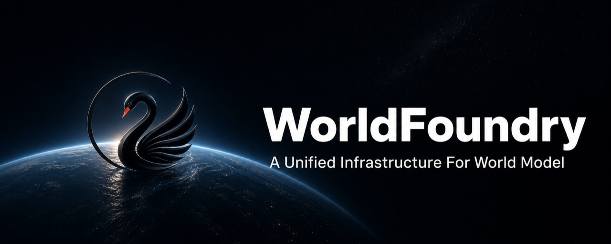

# WorldFoundry

[](pyproject.toml)
[](LICENSE)
[](https://github.com/OpenEnvision/WorldFoundry/actions/workflows/ci.yml)
[](https://openenvision.github.io/WorldFoundry/docs)

[Documentation](https://openenvision.github.io/WorldFoundry/docs) · [中文文档](https://openenvision.github.io/WorldFoundry/zh/docs) · [Contributing](CONTRIBUTING.md)

WorldFoundry is an open-source framework for world-model inference and evaluation.
It brings video generation, interactive worlds, 3D/4D reconstruction, and embodied action into a shared workflow.



## 📰 News

- **[2026-07-12]** 🔥 **WorldFoundry reached 100+ stars on its very first day!** Thanks to the community for the incredible support and encouragement. More exciting updates are coming!
- **[2026-07-11]** 🎉 **WorldFoundry is officially open-sourced.** We welcome ⭐ stars, bug reports, feature requests, and pull requests from the community!

## 🤝 Community

Join the **WorldFoundry Community** on Slack, [Discord](https://discord.gg/ybUQMDA4x), or WeChat for discussions, announcements, technical support, and the latest project updates.

<p align="center">

<a href="https://join.slack.com/t/worldfoundrycommunity/shared_invite/zt-43nbi9fw4-okYiELzZHp0_1UPa3dh3bQ">
  
</a>

<a href="https://github.com/OpenEnvision/WorldFoundry/issues">
  
</a>

</p>

<p align="center">
  <strong>WeChat Community</strong>
</p>

<table align="center">
  <tr>
    <td align="center"><strong>Group 1 — Full</strong></td>
    <td align="center"><strong>Group 2 — Full</strong></td>
    <td align="center"><strong>Group 3 — Open</strong></td>
  </tr>
  <tr>
    <td align="center"></td>
    <td align="center"></td>
    <td align="center"></td>
  </tr>
</table>

<p align="center">
  <em>Groups 1 and 2 are full. Scan the Group 3 QR code to join.<br>
  QR codes are updated periodically if they expire.</em>
</p>

## Highlights

- **Model and benchmark catalogs** — discover models, checkpoint sources, runtime requirements, and benchmark protocols.
- **Unified inference** — run in-tree pipelines through the CLI, terminal UI, or browser-based Studio.
- **Artifact inspection** — review job status, generated media, and geometry through Studio and its visualizers.
- **Benchmark evaluation** — run model × benchmark cells and inspect normalized metrics, readiness, and eligibility scorecards.

## System Requirements

- **Platform:** Linux with an NVIDIA CUDA-capable GPU.
- **Driver:** CUDA 12.8+ support for the default unified environment.
- **GPU architecture / VRAM:** model-specific; check the selected model's page.
- **Tools:** Git and Conda.

Inference, Studio, evaluation, and development use the same unified CUDA environment.
Model-specific environments for ABI or simulator requirements are documented in the
[environment guide](https://openenvision.github.io/WorldFoundry/docs/reference/environments).

## Quickstart

Clone the repository, create the GPU environment, and launch Studio:

```bash
GIT_LFS_SKIP_SMUDGE=1 git clone https://github.com/OpenEnvision/WorldFoundry.git
cd WorldFoundry

bash scripts/setup/bootstrap_worldfoundry.sh
source tmp/worldfoundry_unified_env.sh
conda activate "${WORLDFOUNDRY_UNIFIED_ENV_PREFIX}"

bash scripts/workspace/run_workspace.sh --host 127.0.0.1 --port 7870
```

Open **http://127.0.0.1:7870/** to configure inference jobs and inspect their outputs.
On a remote GPU machine, forward port `7870`; additional viewer ports are listed in the
[Studio guide](https://openenvision.github.io/WorldFoundry/docs/guides/studio).

Checkpoints, datasets, API keys, and generated artifacts stay outside git.
Before running a model, prepare its assets using the
[model page](https://openenvision.github.io/WorldFoundry/docs/guides/supported-models) and
[local asset guide](https://openenvision.github.io/WorldFoundry/docs/guides/local-assets).

Prefer the terminal? Run `worldfoundry-eval tui` in the same environment to build a runnable command.
The [full Quickstart](https://openenvision.github.io/WorldFoundry/docs/quickstart) walks through assets,
inference, and evaluation.

## Documentation

Browse the documentation in [English](https://openenvision.github.io/WorldFoundry/docs)
or [中文](https://openenvision.github.io/WorldFoundry/zh/docs).

| Task | Guide |
| --- | --- |
| Choose a model or benchmark | [Models](https://openenvision.github.io/WorldFoundry/docs/guides/supported-models) · [Benchmark Hub](https://openenvision.github.io/WorldFoundry/docs/evaluation/benchmark-hub) |
| Prepare environments and assets | [Environments](https://openenvision.github.io/WorldFoundry/docs/reference/environments) · [Local assets](https://openenvision.github.io/WorldFoundry/docs/guides/local-assets) |
| Run inference from the terminal | [Inference](https://openenvision.github.io/WorldFoundry/docs/guides/inference) · [CLI](https://openenvision.github.io/WorldFoundry/docs/reference/cli) |
| Use the browser workspace | [Studio](https://openenvision.github.io/WorldFoundry/docs/guides/studio) |
| Tune inference | [Inference optimization](https://openenvision.github.io/WorldFoundry/docs/guides/inference-optimization) |
| Score generated outputs | [Evaluation](https://openenvision.github.io/WorldFoundry/docs/evaluation) |

## Contributing

See [CONTRIBUTING.md](CONTRIBUTING.md) for GPU development setup, coding conventions,
tests, DCO sign-off, and the PR workflow.

- [Architecture](https://openenvision.github.io/WorldFoundry/docs/maintainers/architecture) — module boundaries and execution flow.
- [Validation](https://openenvision.github.io/WorldFoundry/docs/reference/validation) — fast checks, CUDA contracts, and real-checkpoint evidence.
- [Agent Skills](skills/index.md) — model integration, optimization, and maintenance workflows.

Community standards and private vulnerability reporting are covered by the
[Code of Conduct](CODE_OF_CONDUCT.md) and [Security Policy](SECURITY.md).

## Citation

If you use WorldFoundry in research, cite this repository and the upstream methods,
checkpoints, datasets, and benchmarks that your work depends on.

## License

WorldFoundry-authored code is licensed under the [Apache License 2.0](LICENSE), except where a file or component carries a different license notice. Vendored and adapted upstream components remain subject to their original licenses, collected in [THIRD-PARTY-NOTICES](THIRD-PARTY-NOTICES).

## Acknowledgment

WorldFoundry builds on upstream world-model, video-generation, reconstruction, and embodied-action projects.
See the model pages and [upstream license guide](https://openenvision.github.io/WorldFoundry/docs/reference/vendored-licenses) for attribution.

We also thank:

- [FastVideo](https://github.com/hao-ai-lab/FastVideo) — a unified inference and post-training framework for accelerated video generation
- [OpenWorldLib](https://github.com/OpenDCAI/OpenWorldLib) — a unified codebase for advanced world models
- [VLA Evaluation Harness](https://github.com/allenai/vla-evaluation-harness) — one framework to evaluate VLA models on robot simulation benchmarks
